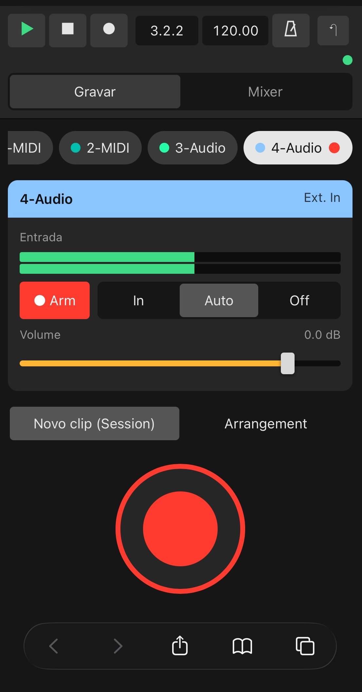
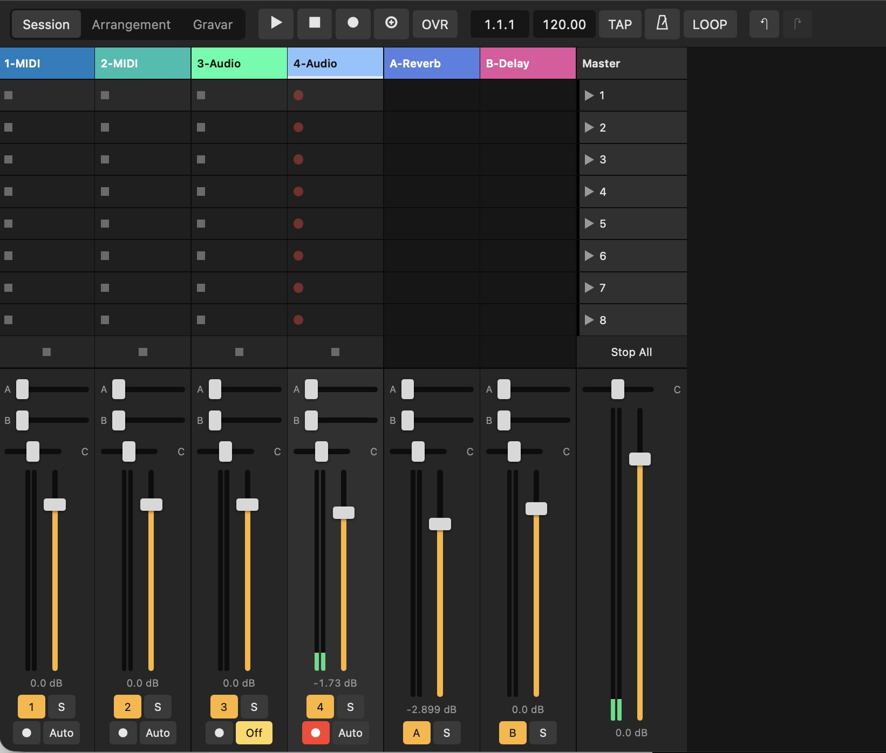
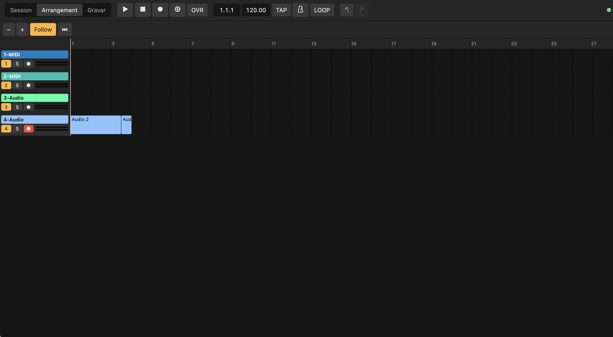

# Live Remote

Control your **Ableton Live** session from a phone or tablet browser — built for recording yourself
when the instrument is far from the computer.

Open an address on your iPhone/iPad (same Wi-Fi as the Mac) and get a Live-like Session and
Arrangement view, a mixer, transport, and a simplified **Record** screen with a big REC button and
input meters. Nothing to install on the phone.

<p align="center">
  
  
</p>
<p align="center">
  
</p>

## Features

- **Session view** (tablet/desktop): clip grid with scene launch, per-track stop, playing/recording/
  triggered states with clip progress; mixer with sends, pan, volume, meters, mute/solo/arm/monitor.
- **Arrangement view**: timeline with clips, playhead, loop region, zoom and Follow; tap the ruler to
  move the playhead.
- **Record screen** (default on phones): pick a track, watch its input level, set arm/monitor/volume,
  and hit one big button.
  - *New clip (Session)*: records into the next empty slot from the selected scene; tap again to stop.
  - *Arrangement*: arms the track and starts Arrangement Record; tap again to stop.
- **Transport** everywhere: play, stop, record, session record, overdub, metronome, tap tempo, loop,
  undo/redo.
- Touch-friendly faders (relative drag, double-tap resets to 0 dB), live state sync with every change
  made in Live, ~10 Hz meters, works with several devices at once.
- Installable to the iPhone home screen (Share → *Add to Home Screen*) for a full-screen app.

## Requirements

- macOS 12+ on **Apple Silicon**.
- **Ableton Live 11** (tested with 11.3) — any edition: this uses a MIDI Remote Script, not Max for
  Live. Live 12 should work as well but has not been tested yet.
- A phone/tablet on the same network as the Mac.

## Install

### Option 1 — one-line installer (recommended)

```sh
curl -fsSL https://raw.githubusercontent.com/nagualcode/abletonweb/main/install.sh | bash
```

It downloads the latest release, installs **Live Remote.app** in `/Applications`, installs the
LiveWeb Remote Script into Live's User Library and starts the bridge service. Then:

1. Restart Ableton Live → **Settings → Link, Tempo & MIDI** → in a free **Control Surface** slot choose
   **LiveWeb** (Input and Output: *None*).
2. Open **Live Remote** and scan the QR code with your phone.

### Option 2 — download the app

1. Download `LiveRemote-vX.Y.Z-macos-arm64.zip` from [Releases](https://github.com/nagualcode/abletonweb/releases)
   and drag **Live Remote.app** to Applications.
2. The app is not notarized by Apple, so macOS blocks the first launch of downloaded copies. Run once:
   ```sh
   xattr -dr com.apple.quarantine "/Applications/Live Remote.app"
   ```
   (or try to open it, then *System Settings → Privacy & Security → Open Anyway*).
3. Open Live Remote and click **Install**, then select **LiveWeb** in Live as above.

### Option 3 — without the app window (terminal only)

The app's executable is also a command-line tool; the window is optional:

```sh
LR="/Applications/Live Remote.app/Contents/MacOS/live-remote"
"$LR" install    # Remote Script + bridge service (starts at login, restarts if it dies)
"$LR" url        # address to open on the phone, with a QR code in the terminal
"$LR" status     # service / bridge / Live status
"$LR" help       # all commands (uninstall, restart, install-script, serve)
```

### Option 4 — build from source

Needs [Rust](https://rustup.rs) and [Node.js](https://nodejs.org) (only to build the web app).

```sh
git clone https://github.com/nagualcode/abletonweb.git && cd abletonweb
./scripts/build-app.sh --install     # builds web app + Rust app, copies to /Applications
"/Applications/Live Remote.app/Contents/MacOS/live-remote" install
```

## Using it

- On the phone, open the address shown by the app (e.g. `http://YourMac.local:6090`). The `.local`
  name keeps working when the router changes the Mac's IP.
- The **Live Remote** app shows whether the service is running, whether Live is connected, how many
  devices are connected, and the QR code. You don't need to keep it open: the bridge runs as a
  background service and reconnects to Live whenever Live starts.
- Solo and Arm are exclusive by default (like Live's defaults); Cmd/Ctrl-click on desktop adds to the
  selection.
- Over plain `http://` on a LAN, iOS does not let pages keep the screen awake; disable Auto-Lock while
  recording.

## Settings

The app's *Settings* section edits `~/.config/abletonweb/config.json`:

```json
{
  "port": 6090,
  "livePort": 9877,
  "requireToken": false,
  "token": "…"
}
```

- **port** — HTTP/WebSocket port the phone connects to.
- **requireToken** — when `true`, each device must open the address once with `?t=<token>` (the app's
  QR code includes it; it is then remembered by the browser).

**Security without a token:** any device on your LAN can control Live, but web pages from other sites
cannot — browsers allow any website to open WebSockets to LAN addresses, so the bridge only accepts
WebSocket connections whose `Origin` matches its own address and whose host is an IP, `localhost` or
`*.local` (which also blocks DNS-rebinding). Turn the token on if you don't trust your network.

## How it works

```
Ableton Live ── Remote Script "LiveWeb" (Python, runs inside Live)
                    │ newline-delimited JSON over TCP 127.0.0.1:9877
               live-remote serve  (Rust bridge, LaunchAgent)
                    │ HTTP + WebSocket :6090 — full state, then JSON patches + meter ticks
               Browser (Svelte web app, embedded in the binary)
```

- `remote_script/LiveWeb/` — MIDI Remote Script (Python 3.7-compatible for Live 11). It observes the
  Live Object Model through listeners, sends a state snapshot whenever something changes plus a meter
  "tick" every ~100 ms, and executes commands on Live's main thread.
- `app/` — one Rust binary: the control panel (egui), the bridge (`serve`: axum/tokio, diffs states
  into patches, per-client backpressure) and the installer commands. The web app and the Remote Script
  are embedded, so the app works from wherever it is installed; if it is moved, the service is updated
  the next time the app opens.
- `web/` — the browser UI (Svelte 5 + Vite).
- `tests/mock_live/` — a fake Live song that runs the real Remote Script outside of Live.

The bridge and the Remote Script are deliberately separate processes: Live's embedded Python stays
small and safe, and the network-facing server can restart without touching Live.

## Development

```sh
# web app with hot reload (talks to the bridge on :6090)
cd web && npm ci && npm run dev

# bridge / app
cd web && npm run build && cd ../app
cargo run                 # control panel
cargo run -- serve        # bridge in the foreground
cargo test

# without Ableton: run the real Remote Script against a fake song
LIVEWEB_PORT=9878 python3 tests/mock_live/run_mock_live.py
LIVE_PORT=9878 PORT=6091 cargo run -- serve      # then open http://localhost:6091

# release zip (dist/)
./scripts/build-app.sh --zip
```

Remote Script changes are installed with `live-remote install-script` (or the app) and need a Live
restart. Logs: `~/Library/Logs/abletonweb/bridge.log` (bridge) and Live's `Log.txt` (lines starting
with `LiveWeb:`).

### Remote Script commands

Tracks are addressed as `t<i>` (tracks), `r<i>` (returns) and `m` (master).

- Transport: `play`, `stop`, `continue`, `toggle_play`, `record {value?}`, `session_record {length?}`,
  `tap_tempo`, `undo`, `redo`, `stop_all_clips`, `capture_midi`, `re_enable_automation`
- `set_song {prop, value}`: `record_mode`, `session_record`, `metronome`, `arrangement_overdub`,
  `session_automation_record`, `loop`, `back_to_arranger`, `tempo`, `current_song_time`,
  `loop_start`, `loop_length`
- `set_track {track, prop, value}`: `volume`, `pan`, `send` (+`index`), `mute`, `solo` (+`exclusive`),
  `arm` (+`exclusive`), `monitor` (`in`/`auto`/`off`), `folded`, `name`
- `select_track`, `stop_track {track}`; `select_scene`, `fire_scene {scene}`
- `fire_slot`, `stop_slot`, `delete_clip {track, scene}`
- `record_into_track {track, scene?, exclusive?}` — arm, select and record into the first empty slot
- `get_state`, `ping`

## Uninstall

Click **Uninstall** in the app (or `live-remote uninstall`), delete `/Applications/Live Remote.app`,
the `LiveWeb` folder in your User Library's `Remote Scripts`, and `~/.config/abletonweb`.

## License

[MIT](LICENSE). Not affiliated with or endorsed by Ableton. "Ableton" and "Live" are trademarks of
Ableton AG.
